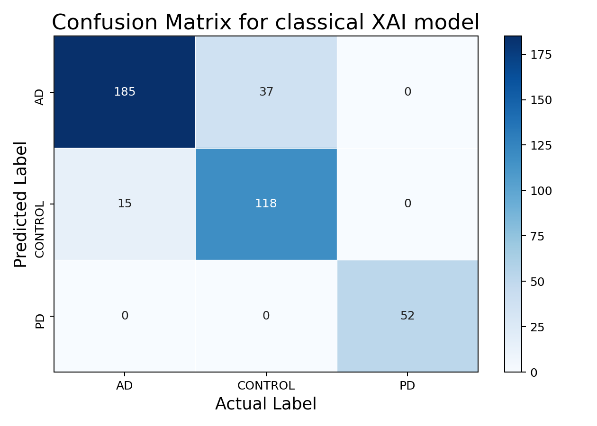
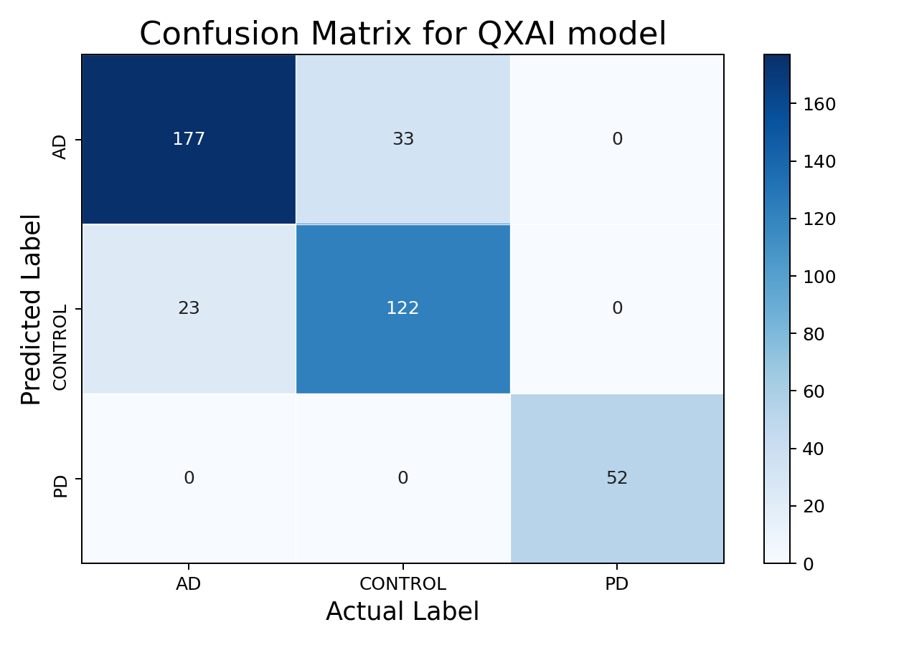
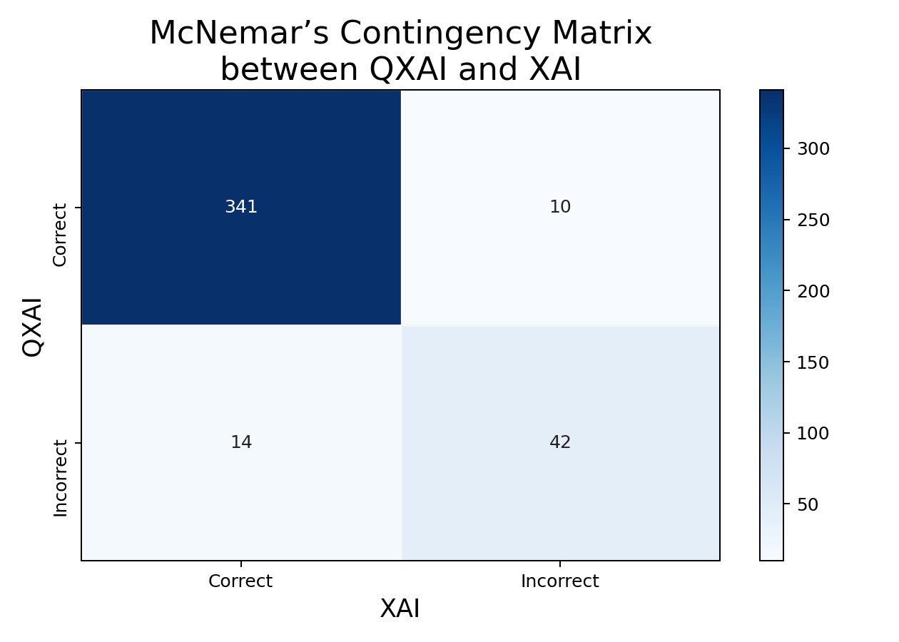

# QXAI Research Platform

**A research platform for comparing classical and simulated quantum–classical explainable AI on brain MRI images.** QXAI provides model comparisons, saliency visualizations, private analysis histories, and downloadable reports.

[](https://blue-qxai-prj.netlify.app/) [](https://blue-qxai-prj.netlify.app/) [](#research-scope-and-safety)

> **Research only.** These models are not clinically validated, their scores are not calibrated clinical confidence, and they must not be used to diagnose or guide patient care.

## Contents

- [What the platform does](#what-the-platform-does)
- [Current model evaluation](#current-model-evaluation)
- [How the models work](#how-the-models-work)
- [Developer reflection](#developer-reflection)
- [Platform and deployment](#platform-and-deployment)
- [IBM SkillsBuild cloud fundamentals in practice](#ibm-skillsbuild-cloud-fundamentals-in-practice)
- [Run locally](#run-locally)
- [Repository guide](#repository-guide)
- [Research scope and safety](#research-scope-and-safety)

## What the platform does

- Compares classical XAI and quantum–classical QXAI predictions and saliency maps.
- Supports account sign-in, private per-user analysis histories, and private scan storage.
- Provides an administrator review area with uploader and processing details.
- Exports analyses as PDF, self-contained HTML, or JSON, including the original image filename.
- Includes a Project Guide chat that retrieves reviewed public project facts and selected figures; live LLM answers use a backend-only provider configuration.
- Processes model jobs through a background worker with bounded retries, timeouts, and recovery.
- Includes service health checks and encrypted local backups with offline recovery verification.

The deployed demo is hosted at [blue-qxai-prj.netlify.app](https://blue-qxai-prj.netlify.app/). The previous `qxai-fullstack-prj` site remains separate and is not the deployment target for this repository.

## Current model evaluation

The current comparison uses the cleaned [AD/PD v3 dataset](https://www.kaggle.com/datasets/jasirvatham2602/classifying-ad-and-pd-v3), dataset version 12. It contains 2,021 intended three-class images, partitioned into 1,413 training, 201 validation, and 407 test images. Exact duplicate groups are separated across partitions. The dataset does not provide subject identifiers, so patient-level independence cannot be established.

| Model | Test accuracy | Correct | Macro F1 |
|---|---:|---:|---:|
| Classical XAI | **87.22%** | 355 / 407 | 0.8987 |
| Quantum XAI | **86.24%** | 351 / 407 | 0.8922 |

The locked test set was evaluated after model selection. EfficientNet-B0 parameters remain frozen while BatchNorm statistics adapt during training. XAI trained for 10 epochs and selected epoch 9 by validation; QXAI trained for 5 epochs and selected epoch 5. The quantum circuit runs in a classical simulator; these results do not show quantum advantage.

### Confusion matrices

Rows show predicted labels; columns show actual labels, matching the original research figures.

<p align="center">
  
  
</p>

### Paired McNemar comparison

| QXAI / XAI correctness | XAI correct | XAI incorrect |
|---|---:|---:|
| QXAI correct | 341 | 10 |
| QXAI incorrect | 14 | 42 |

Exact two-sided McNemar **p = 0.5413**; the continuity-corrected result is chi-square **0.375**, p **0.5403**. The observed 0.98 percentage-point difference is not statistically significant at alpha 0.05 or 0.10. This does not establish that the models are equivalent. The missing subject identifiers also limit conclusions that assume independent patients.

<p align="center"></p>

Details: [model card](models/candidates/cleaned-v3-seed42/MODEL_CARD.md) · [statistical report](models/candidates/cleaned-v3-seed42/STATISTICAL_COMPARISON.md) · [paired predictions](models/candidates/cleaned-v3-seed42/paired_test_predictions.json) · [training and reproduction guide](training/README-v3.md).

Earlier reported results (including 89.46% XAI and 86.52% QXAI) use a different experimental setup and test set. They are preserved in the historical [protocol audit](training/PROTOCOL_AUDIT.md) and must not be treated as a direct comparison with the cleaned v3 results above.

## How the models work

Both models use an EfficientNet-B0 image feature extractor and classify the three dataset categories: Alzheimer’s disease (AD), Parkinson’s disease (PD), and control. Classical XAI uses a classical classification head. QXAI maps image features into a four-qubit variational circuit, then uses measured circuit outputs for classification. PennyLane simulates the circuit on a classical computer. Saliency maps help visualize which image regions influenced a prediction; they do not explain or validate a clinical diagnosis.

The project’s original research write-up, including its architecture illustrations and historical saliency examples, is available in [`docs/original-research/`](docs/original-research/README.md).

## Developer reflection

My favorite part of developing this project was learning how quantum machine learning works. Building the bottleneck architecture fascinated me and helped me apply concepts I learned in CSI 4900 Quantum Computing at Oakland University.

## Platform and deployment

| Layer | Technology and role |
|---|---|
| Web app | React + Vite, deployed on Netlify |
| API and worker | Python + FastAPI, Dockerized and hosted in the existing Hugging Face CPU Basic Space |
| Accounts and records | Supabase Auth, PostgreSQL with row-level security, and private object storage |
| Inference | PyTorch + PennyLane, with a four-qubit circuit simulation |
| Automation | GitHub Actions and Netlify deployment workflow |

### Recent platform update

The current full-stack version adds a unified research workflow: signed-in users can submit analyses, revisit their own histories, and download reports; the administrator review view includes scan uploader information and model-processing metadata. Cross-origin sign-in was adjusted for the Netlify frontend and Hugging Face API so the browser can submit the credential request successfully. The older README’s results, setup commands, and deployment notes have been replaced here with the current evaluation and service layout.

**Demo administrator access:** this public demonstration has a shared administrator login configured through the backend’s private environment settings. Anyone who knows the shared credentials can view scans and uploader details from all demo users. Do not submit identifiable or sensitive images. This is a demo convenience, not a secure multi-tenant production administrator design. For a real deployment, disable the shared demo login and use individually verified administrator accounts with least-privilege access. Never put the demo password or server secrets in this repository or frontend.

The free hosting tiers may sleep or cold-start. Analysis records remain until their owner deletes them; automatic cleanup is disabled.

## IBM SkillsBuild cloud fundamentals in practice

After completing **IBM SkillsBuild Cloud Computing Fundamentals**, I applied cloud concepts to the project using its existing providers (Hugging Face, Netlify, and Supabase; the app is **not** hosted on IBM Cloud):

- **Cloud service composition:** separated the React interface, Python API/background worker, managed database, authentication, and object storage into independently hosted services.
- **Virtualization and packaging:** packaged the API and worker with Docker so the runtime and dependencies are consistent in the hosted environment.
- **Data management and security:** kept service credentials in backend environment secrets, used managed PostgreSQL, private image storage, and row-level policies to isolate user histories.
- **Reliability and operations:** added health checks, worker heartbeats, bounded retries and timeouts, recovery handling, CI/CD, and encrypted backups to support operation and troubleshooting.

This is a practical application of cloud fundamentals to a deployed student project, not a claim of IBM Cloud certification or IBM Cloud deployment.

## Run locally

For the frontend development server:

```sh
npm ci
npm run dev -- --host 127.0.0.1 --port 5174
```

Copy the example environment files and configure your own Supabase and backend settings. Frontend `VITE_` variables are public; keep server credentials only in the backend environment. See [DEPLOYMENT.md](DEPLOYMENT.md) for API, worker, schema, and configuration details. Reproducing model training requires the separate environment described in the [v3 training guide](training/README-v3.md); place downloaded data in ignored `training/data/`.

## Repository guide

| Path | Contents |
|---|---|
| `src/`, `public/` | React application and static assets |
| `backend/` | Authenticated API, inference, worker, and operations |
| `supabase/migrations/` | Versioned database schema and access policies |
| `training/` | Reproducible training, protocol audit, and evaluation scripts |
| `models/candidates/cleaned-v3-seed42/` | Candidate checkpoints, model card, and measured results |
| `docs/original-research/` | Preserved original research write-up |
| `DEPLOYMENT.md` | Service setup and deployment configuration |

Downloaded datasets, feature caches, credentials, uploaded scans, and private backups must not be committed.

## Research scope and safety

The platform is an educational and research demonstration. It can make incorrect predictions, including on images from the same dataset. Do not treat a model prediction or heatmap as medical advice or a diagnosis. Use only images you have permission to analyze, and avoid identifiable or protected health information in the public demo.
