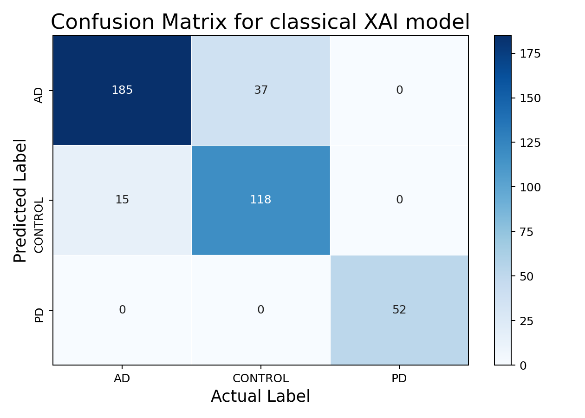
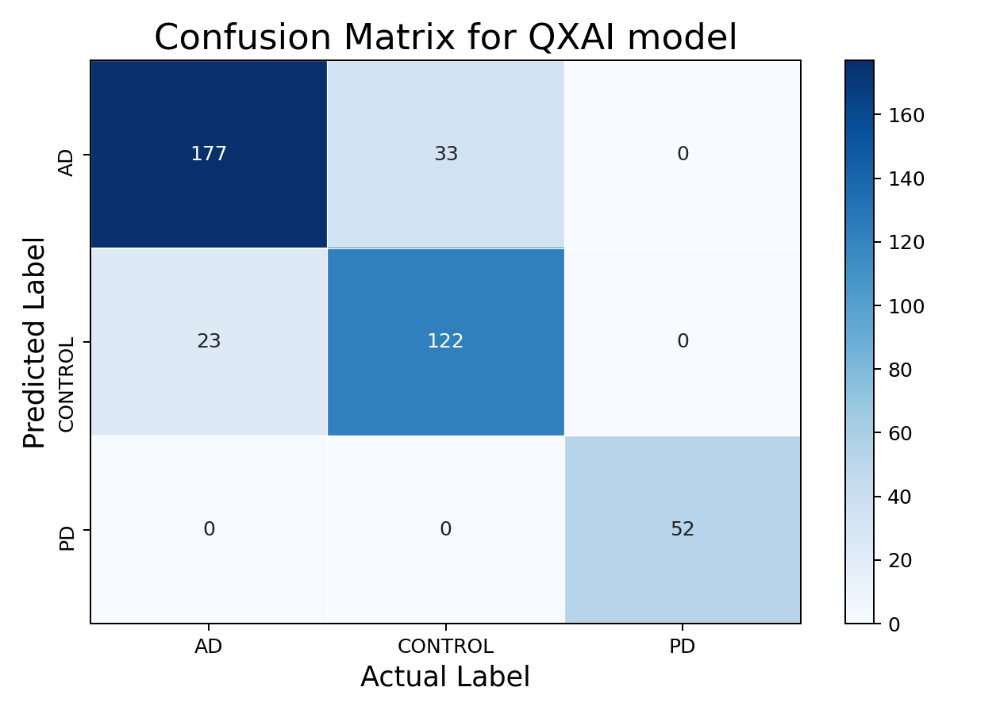
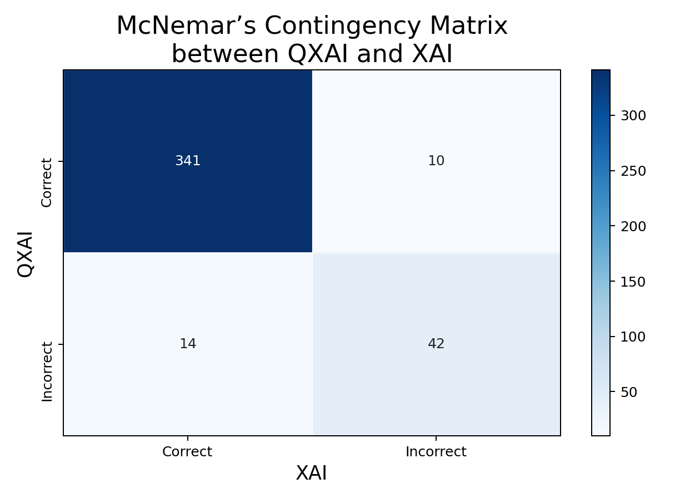

# QXAI — Classical and Quantum Explainable AI

An MRI research workspace comparing a classical EfficientNet classifier with a simulated quantum–classical hybrid. Upload a public or synthetic research image, compare predictions and saliency maps, revisit private analysis histories, and export the evidence as a PDF.

**[Open the research demo](https://qxai-fullstack-prj.netlify.app/)** · [Training and reproduction](training/README-v3.md) · [Deployment guide](DEPLOYMENT.md)

This repository contains the frontend, Python API, background worker, database migrations, model checkpoints, training code, and evaluation results. Research use only; the models are not clinically validated and scores are not calibrated clinical confidence.

## Current model results

Both models use the cleaned [AD/PD v3 dataset](https://www.kaggle.com/datasets/jasirvatham2602/classifying-ad-and-pd-v3), official dataset version 12. The 2,021 intended three-class images were split before training: 1,413 training, 201 validation, and 407 test images. The separate binary copies were excluded. Exact duplicate groups are disjoint across partitions; no subject identifiers were supplied, so patient independence is not established.

| Model | Test accuracy | Correct / total | Macro F1 |
|---|---:|---:|---:|
| Classical XAI | **87.22%** | 355 / 407 | 0.8987 |
| Quantum XAI | **86.24%** | 351 / 407 | 0.8922 |

Original architectures and actual raw-input preprocessing were preserved. EfficientNet-B0 parameters remain frozen; BatchNorm statistics adapt during CNN training. XAI trained for 10 epochs, selecting epoch 9 by validation; QXAI trained for 5 epochs, selecting epoch 5. The locked test set was evaluated after model selection. The quantum circuit is simulated on a classical computer; this does not demonstrate quantum advantage.

<p>
  
  
</p>

Rows are predicted labels; columns are actual labels, matching the original research figures.

### Paired statistical comparison

| QXAI / XAI | XAI correct | XAI incorrect |
|---|---:|---:|
| QXAI correct | 341 | 10 |
| QXAI incorrect | 14 | 42 |

Exact two-sided McNemar **p = 0.5413**. The continuity-corrected test gives chi-square **0.375**, p **0.5403**. The observed 0.98 percentage-point accuracy difference is not statistically significant at alpha 0.05 or 0.10. Non-significance does not establish equivalence. Unknown subject clustering limits the independence assumption.



See the [model card](models/candidates/cleaned-v3-seed42/MODEL_CARD.md), [statistical report](models/candidates/cleaned-v3-seed42/STATISTICAL_COMPARISON.md), and [paired predictions](models/candidates/cleaned-v3-seed42/paired_test_predictions.json). The earlier full-dataset experiment and original reported results use different exact test sets and remain documented separately; their percentages are not a paired improvement comparison.

## Research workspace

- Email sign-in, owner-only histories, and private input/saliency image storage.
- Classical and quantum model comparisons, probability bars, filename search, date/status filters, and original filenames in reports.
- PDF, self-contained HTML, and JSON exports.
- Restricted administrator review with uploader details and model-processing metadata.
- Background processing with bounded retries, timeouts, abandoned-job recovery, atomic claims, and model self-tests.
- Health checks, CI, and encrypted local application backups with verified offline recovery.
- Records remain until their owner deletes them; automatic cleanup is disabled.

| Component | Implementation / hosting |
|---|---|
| Frontend | React + Vite on Netlify |
| API and worker | Python + FastAPI in the existing Hugging Face CPU Basic Docker Space |
| Authentication, database, private images | Supabase Auth, PostgreSQL RLS, private Storage |
| Models | PyTorch + PennyLane; four simulated qubits and four entangler layers |

Free hosting may sleep or cold-start. The production admin panel uses a verified administrator account. The optional local development shared-password login is disabled in production.

## Run the app locally

```sh
npm ci
npm run dev -- --host 127.0.0.1 --port 5174
```

Copy the example environment files and configure your own project. Frontend VITE settings contain only public values. Server secrets belong only in the backend environment. See [DEPLOYMENT.md](DEPLOYMENT.md) for API/worker startup, schema, and configuration.

```sh
npm test
npm run build
python -m pytest backend/tests -q
```

Backend tests require `backend/requirements-ops.txt` and pytest. Training uses its separate [documented environment and commands](training/README-v3.md). Download the dataset into ignored `training/data/`; downloaded datasets, feature caches, credentials, uploads, and private backups must not be committed.

## Repository map

- `src/`, `public/`: web application.
- `backend/`: authenticated API, inference, worker, access controls, and operations.
- `supabase/migrations/`: versioned database setup.
- `training/`: reproducible training, protocol audit, verification, and paired comparison.
- `models/candidates/cleaned-v3-seed42/`: deployed checkpoint bundle and measured results.
- `docs/original-research/README.md`: preserved original research write-up. The original root `main.py`, figures, and dataset archive remain for historical reproduction.

The original project investigated quantum and classical saliency explanations. See the [protocol audit](training/PROTOCOL_AUDIT.md) for the distinction between its reported 89.46% / 86.52% and the current cleaned-data experiment. The original write-up's claim of differing accuracy used alpha 0.10; the current paired comparison finds no significant difference.
