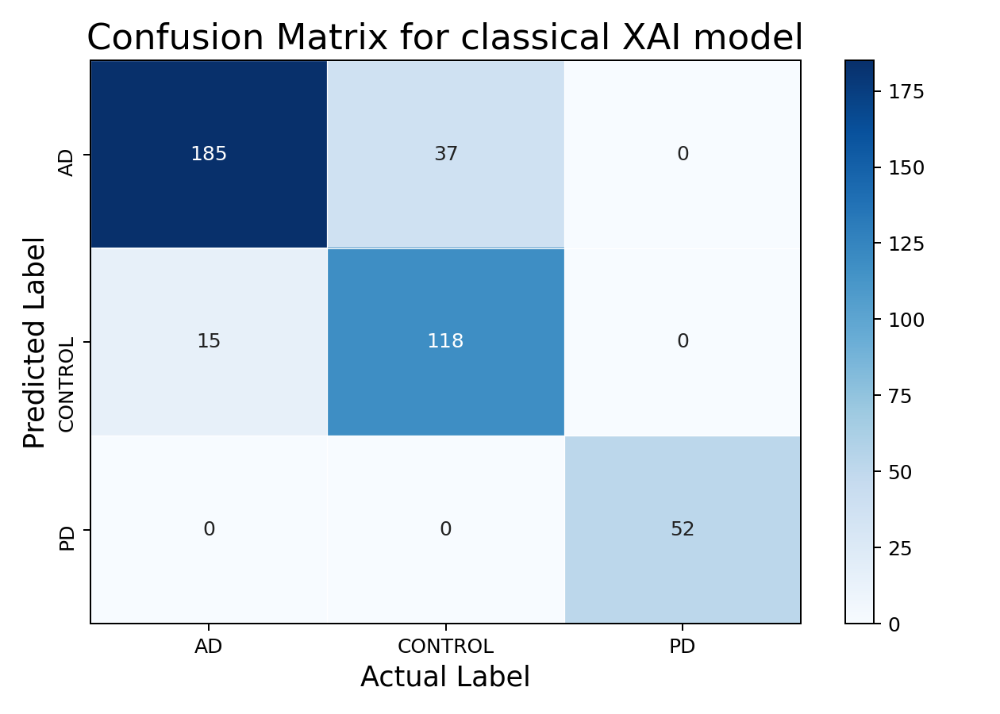
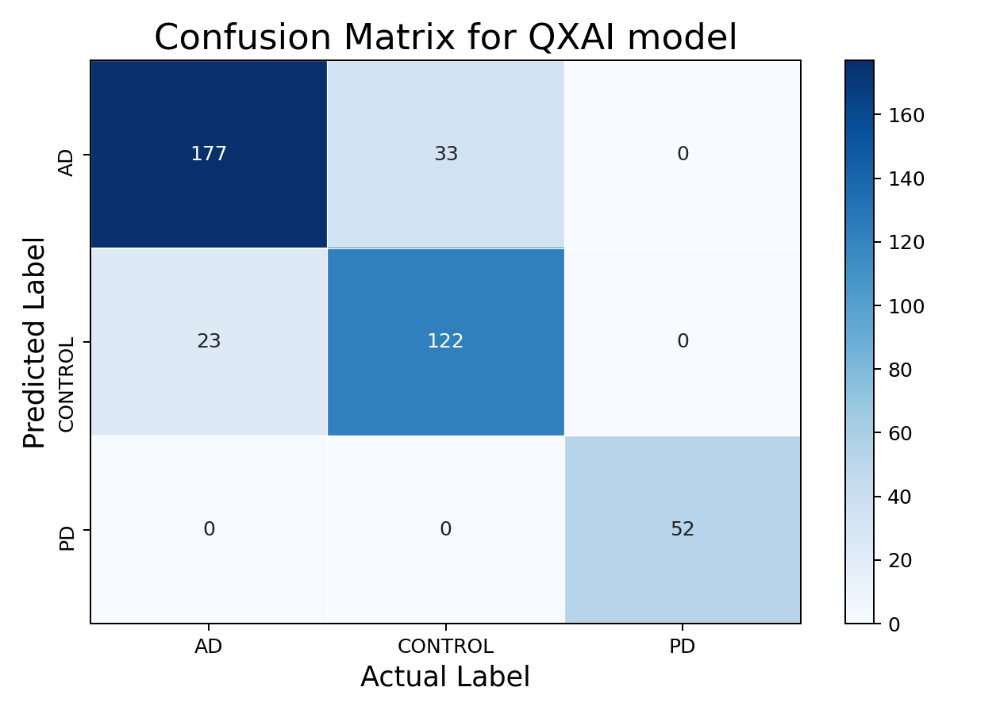
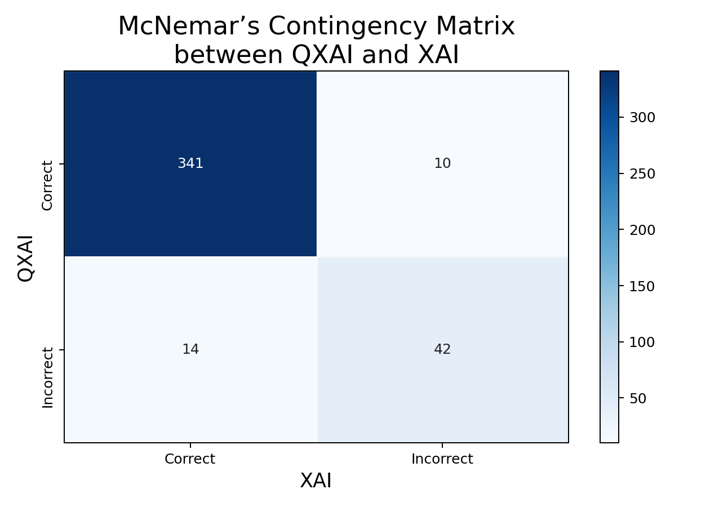

# Paired XAI and QXAI comparison

Fixed cleaned-v3 checkpoints on the same 407 test images; no retraining or selection. XAI: 355/407 (87.22%); QXAI: 351/407 (86.24%).

| QXAI / XAI | Correct | Incorrect |
|---|---:|---:|
| Correct | 341 | 10 |
| Incorrect | 14 | 42 |

Two-sided exact McNemar p = 0.541256. Continuity-corrected chi-square = (|10-14|-1)^2/24 = 0.375, p = 0.540291. Exact binomial is the primary result because there are only 24 discordant pairs. Neither test finds a statistically significant difference at alpha .05 or .10. This does not establish equivalence or quantum advantage. Unknown subject clustering limits the independence assumption.

Confusion matrices match the original repository orientation: rows predicted, columns actual. Earlier evaluation.json uses rows actual, columns predicted, so these figures deliberately transpose those arrays.

Method reference: https://www.statsmodels.org/stable/generated/statsmodels.stats.contingency_tables.mcnemar.html
